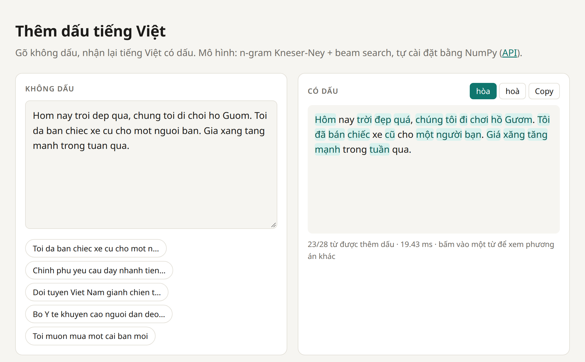
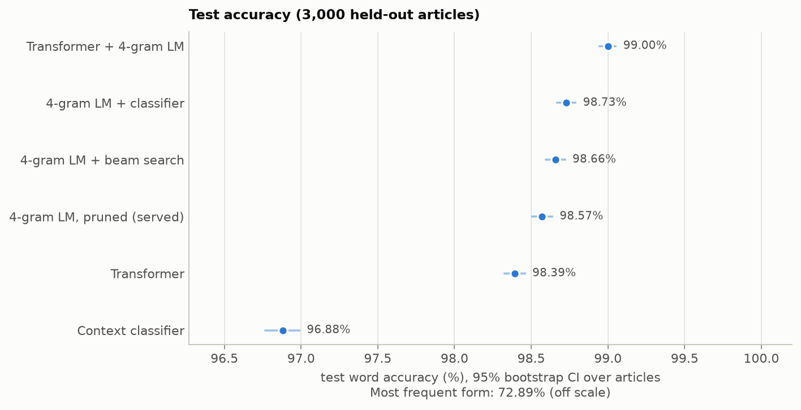
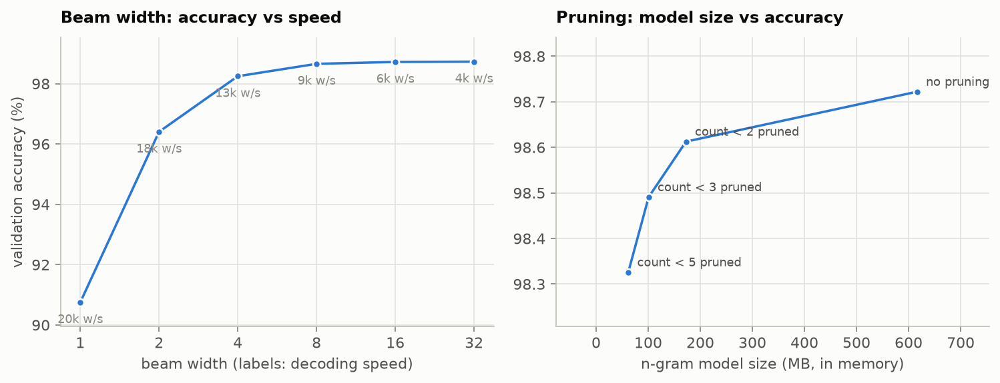
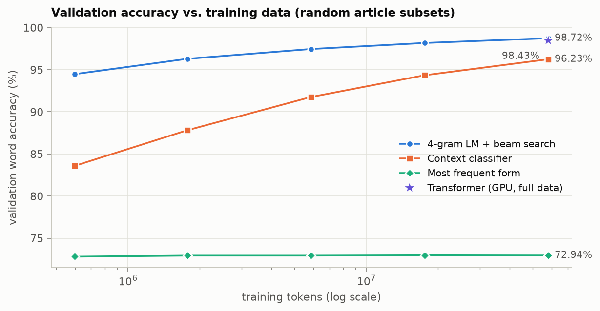

# vietnamese-diacritic-restoration

[](https://github.com/hoang-stack/vietnamese-diacritic-restoration/actions/workflows/ci.yml)


**"Toi da ban chiec xe cu cho mot nguoi ban" → "Tôi đã bán chiếc xe cũ cho một người bạn".**
Vietnamese written without diacritics is everywhere (old keyboards, SMS, URLs, search queries),
and restoring the marks is ambiguous: *ban* alone can be bạn, bán, bàn, bản, bắn, ban, bận or
bẩn, and the sentence above needs two different ones. This project restores them with

* a **4-gram Kneser-Ney language model and batched beam search, written from scratch in NumPy**
  (no NLP or ML libraries), which restores about 6,000 words per second on a laptop CPU, and
* a **Transformer tagger trained on a Kaggle GPU**, compared on the same held-out articles, and
  combined with the n-gram model in one decoder.



## Results

Test set: 3,000 held-out news articles (about 1.5 million words), each model evaluated once.
95% CIs come from resampling articles.

| Model | Word accuracy (95% CI) | Ambiguous words | Whole sentence correct | Runs on |
| --- | ---: | ---: | ---: | --- |
| **Transformer + 4-gram LM** | **99.00%** (98.95–99.05) | 98.96% | 82.5% | GPU + CPU |
| 4-gram LM + context classifier | 98.73% (98.67–98.79) | 98.67% | 79.2% | CPU |
| **4-gram LM + beam search** (from scratch) | **98.66%** (98.60–98.72) | 98.60% | 78.4% | CPU |
| 4-gram LM, pruned to 173 MB (served by the API) | 98.57% (98.51–98.64) | 98.51% | 77.2% | CPU |
| Transformer tagger (42.5M parameters) | 98.39% (98.33–98.46) | 98.32% | 73.3% | GPU |
| Context classifier (hashed log-linear) | 96.88% (96.77–96.99) | 96.73% | 58.2% | CPU |
| Most frequent form per syllable | 72.89% | 71.48% | 3.1% | CPU |



### Takeaways

1. **The from-scratch n-gram model beats the 42.5M-parameter Transformer** (98.66% vs 98.39%:
   +0.27 points, 95% CI 0.24–0.30, paired bootstrap p < 0.001). The Transformer sees both directions, but only through stripped
   text. The n-gram decoder conditions on the *accented* words it has already chosen, and that
   turns out to be the stronger signal.
2. **The two are complementary.** Adding the Transformer's log-probabilities to the n-gram
   score (weight 0.5, tuned on validation) gives 99.00%: **25% fewer errors** than the n-gram
   model alone, and 38% fewer than the Transformer alone. Every gap in the table is significant
   (p < 0.001).
3. **Cost matters as much as accuracy.** The served model (pruned n-grams, 173 MB) is 0.09
   points below the full one at 28% of its size, and needs no GPU. The Transformer reaches
   30,000 words/s on a T4 but only 1,300 words/s on 4 CPU threads.
4. **What is still wrong** is mostly function words that need long-range syntax: *nhưng ↔
   những*, *cũng ↔ cùng*, *còn ↔ con*, *có ↔ cô*, *thành ↔ thanh*, *chỉ ↔ chị*.
5. **Published numbers, for orientation only** (different data): a pointwise n-gram approach
   reported 94.7% (Luu & Yamamoto, 2012), phrase-based MT 97.3% and neural MT 96.2% (Pham et
   al., 2017).

## How it works

**1. Candidates.** Every stripped syllable maps to the accented forms seen in training (at
least twice, and inside the model's vocabulary): `ban → bạn, ban, bán, bản, bắn, bàn, bận, bẩn`.
About 95% of the words in running text are ambiguous in this sense.

**2. A syllable 4-gram language model** ([lm.py](src/vidiac/lm.py)) with interpolated modified
Kneser-Ney smoothing (Chen & Goodman, 1998), the estimator behind SRILM and KenLM:

- Lower orders use *continuation counts* (how many distinct words precede an n-gram), not raw
  counts. Three discounts per order come from counts-of-counts.
- Each n-gram is packed into one `int64` (15 bits per token), so counting 25 million 4-grams is
  `np.unique` over integers and lookup is `np.searchsorted`. No Python dictionaries are involved.
- Optional **pruning** drops rare n-grams and *re-normalises* the back-off weights, so every
  conditional distribution still sums to one (checked by the tests).

**3. Decoding** ([restore.py](src/vidiac/restore.py)): beam search over the candidates.
Hypotheses that end in the same three tokens are recombined, because the 4-gram model cannot
tell them apart from then on. With a large enough beam this is exact Viterbi decoding, which a
test checks against brute force. The decoder is **batched**: position *t* of thousands of
sentences is expanded in one vectorised step, which made it 8× faster than decoding sentence by
sentence.

**4. Baselines.** No restoration; most frequent form per syllable; and a discriminative
**context classifier** ([classifier.py](src/vidiac/classifier.py)): multinomial logistic
regression over hashed features of the two syllables on each side (the "pointwise" approach of
Luu & Yamamoto, 2012), trained with Adagrad.

**5. Transformer** ([kaggle/train_transformer.py](kaggle/train_transformer.py)): a 6-layer
encoder (42.5M parameters) reads the whole stripped sentence in both directions and, for each
ambiguous syllable, scores only that syllable's candidates (dot product with an output
embedding per accented form). It imports this package for tokenisation, candidates and scoring,
so its numbers are directly comparable. Its per-candidate log-probabilities can be added to the
n-gram score in the beam search (`λ · log P_Transformer`).

**Text details that matter:** the corpus is NFC-normalised first (the raw text mixes composed
and decomposed characters). Capitalisation is copied from the input, spacing and punctuation are
kept byte for byte, and words the user already typed with marks are left alone. Vietnamese has
two accepted tone-placement styles (*hòa / hoà*, *thủy / thuỷ*). The corpus uses the "new" one,
and the API can output either.

## Data and evaluation protocol

- **Corpus:** [VietNews](https://huggingface.co/datasets/harouzie/vietnews) (Apache-2.0):
  99,134 / 22,184 / 22,498 news articles (train / validation / test), 58M training tokens.
  The source text is word-segmented (`nhân_viên`). The cleaning step undoes that and normalises
  Unicode. Articles are disjoint across splits (checked by hash).
- **Task:** strip all diacritics from an article, restore them, compare word by word.
- **Tuning** on a fixed random sample of 1,000 validation articles (~500k words). **Testing**
  once on a fixed random sample of 3,000 test articles (~1.5M words).
- **Uncertainty:** 95% bootstrap CIs resample *articles*, the unit that was sampled. Words inside
  an article are correlated. Models are compared with a paired bootstrap.
- **Learning curves use random article subsets.** The corpus is ordered by source, so its first
  *n* articles are not representative. A first version of the curve trained on prefixes and
  under-estimated small-data accuracy by up to 5 points (see [the research notes](#development-notes)).

## Analysis

### Order, beam width and model size (validation)

| N-gram order | Accuracy | Model size |
| --- | ---: | ---: |
| No restoration | 17.38% | – |
| Most frequent form | 72.94% | – |
| 2-gram | 97.19% | 24 MB |
| 3-gram | 98.62% | 182 MB |
| 4-gram | **98.72%** | 616 MB |



- **Beam search matters.** Greedy decoding (beam 1) reaches only 90.8%. A beam of 4 gets 98.3%
  at 13k words/s, and the curve flattens after 8 to 16 hypotheses.
- **Pruning** n-grams seen once (adjusted count < 2) cuts the model from 616 to 173 MB for −0.11
  points. Pruning harder (count < 5, 62 MB) costs 0.39 points.

### How much text is needed?



With 1,000 articles (0.6M tokens), the n-gram model already reaches 94.5%, and the
discriminative classifier 83.6%. The classifier keeps improving faster with data (+12.6 points
vs +4.3 points over the curve), but at 58M tokens it still trails the n-gram model by 2.5 points.

### Combining models (validation)

| Decoder score | Accuracy |
| --- | ---: |
| 4-gram LM | 98.72% |
| 4-gram LM + 0.25 × classifier | 98.79% |
| Transformer alone | 98.43% |
| 4-gram LM + 0.5 × Transformer | **99.03%** |
| 4-gram LM + 4 × Transformer | 98.81% |

### Known limitation: the domain

The models learn from news. Everyday chat is out of domain: *"Toi muon mua mot cai ban moi"*
comes back as "…một cái **bạn** mới" (a new *friend*) instead of "bàn" (*table*), because
"cái bạn" is common in news text. The demo lets the user click a word and pick another form,
and fine-tuning on conversational text would be the real fix.

## Quickstart

```bash
git clone https://github.com/hoang-stack/vietnamese-diacritic-restoration.git
cd vietnamese-diacritic-restoration
python -m venv .venv && source .venv/bin/activate
pip install -e ".[dev]"

pytest                             # 49 tests on a toy corpus, ~1 s, no download
vidiac prepare                     # download VietNews (250 MB), clean, tokenise (~3 min)
vidiac train                       # fit the pruned 4-gram model (~1 min, ~5 GB RAM peak)
vidiac restore "Toi da ban chiec xe cu cho mot nguoi ban"
vidiac serve                       # demo at http://127.0.0.1:8000, API docs at /docs
```

Re-running the experiments: `vidiac experiments orders beam prune curve hybrid` (CPU, about an
hour), then `vidiac report`. The Transformer runs on Kaggle: upload `data/kaggle/` as a dataset,
copy `kaggle/kernel-metadata.example.json` to `kernel-metadata.json` with your username, and
`kaggle kernels push -p kaggle --accelerator NvidiaTeslaT4`.

### API

```console
$ curl -s localhost:8000/restore -H 'Content-Type: application/json' \
       -d '{"text": "Hom nay troi dep qua", "style": "old"}' | jq .text
"Hôm nay trời đẹp quá"
```

`POST /restore` also returns every word's position, whether it changed, and its alternative
forms, which the demo page uses to let the user correct a word with one click.

## Project layout

```text
src/vidiac/
├── text.py          NFC, stripping, tokenisation with spans, case transfer, tone styles
├── data.py          VietNews download (checksummed) and cleaning
├── corpus.py        parallel tokenisation into an integer-id cache; random article subsets
├── lm.py            modified Kneser-Ney n-gram LM, packed keys, renormalised pruning
├── restore.py       candidate table, batched beam search, baselines, rendering
├── classifier.py    hashed log-linear context classifier
├── system.py        build / save / load a complete restorer
├── evaluate.py      word / ambiguous / sentence accuracy, article bootstrap, paired tests
├── experiments.py   every experiment stage, appending to results/runs.jsonl
├── report.py        figures and reports/results.md
├── api.py, cli.py   FastAPI service and `vidiac` command; static/ holds the demo page
kaggle/train_transformer.py   Transformer tagger (PyTorch, Kaggle T4 GPU)
```

## Development notes

Things that went wrong, and how they were caught. Each one is now covered by a test or a check.

| Symptom | Cause | Fix |
| --- | --- | --- |
| More training data made the model *worse* (97.8% → 94.9%) | Rare misspelt forms entered the candidate table; outside the vocabulary they all map to `<unk>`, whose probability pools every rare token and so beats the correct form | Candidates must be in the LM vocabulary |
| The whole machine ran out of memory (13.9 GB) | `(B, 1) ^ (B, 1, C)` broadcast to `(B, B, C)` in the feature hashing | Shape regression test; experiments now run in a memory-capped cgroup |
| The Kaggle job could not find its data | Kaggle silently decompresses uploaded `.gz` files | Read both forms; always run a small smoke job first |
| A degenerate count-of-counts gave a zero discount, so `log γ = −∞` | Chen–Goodman formulas on tiny data | Discounts clamped to [0.1, k]; caught by the normalisation tests |
| The learning curve claimed 89% at 1k articles | The corpus is ordered by source, so the first 1k articles are not a random sample of the domain | Random article subsets (94.5% at 1k) |
| Transformer training loss ≈ 50,000 | An out-of-vocabulary gold form (id −1) "matched" a padding slot (also −1) whose logit is −1e9 | `& (cand >= 0)`; model retrained |

## References

- Chen, S. F., Goodman, J. (1998). An empirical study of smoothing techniques for language modeling. Harvard TR-10-98.
- Kneser, R., Ney, H. (1995). Improved backing-off for m-gram language modeling. *ICASSP.*
- Heafield, K. (2011). KenLM: faster and smaller language model queries. *WMT.*
- Stolcke, A. (1998). Entropy-based pruning of backoff language models. (Back-off renormalisation after pruning.)
- Luu, T. A., Yamamoto, K. (2012). A pointwise approach for Vietnamese diacritics restoration. *IALP.*
- Pham, T.-H., Pham, X.-K., Le-Hong, P. (2017). On the use of machine translation-based approaches for Vietnamese diacritic restoration. *arXiv:1709.07104.*
- Weinberger, K. et al. (2009). Feature hashing for large scale multitask learning. *ICML.*
- Vaswani, A. et al. (2017). Attention is all you need. *NeurIPS.*
- Nguyen, V.-H. et al. (2019). VNDS: A Vietnamese dataset for summarization. (VietNews.)
